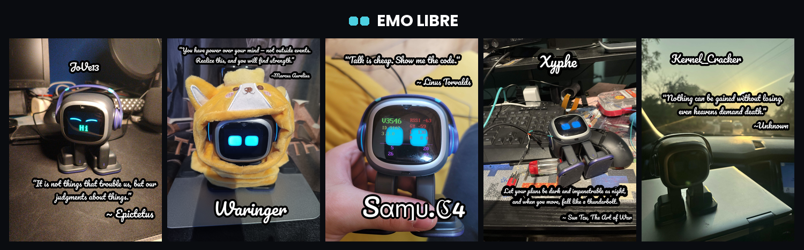

# Knowledge bank, tools, and reverse engineering for EMO by living.ai

This project is to collect and document tools and knowledge of [EMO the desktop robot pet by living.ai](https://living.ai/emo/).
The short term goal for the project is to collect data and information on how the EMO robot works. In the future the hope is to have a toolset to make it possible for EMO to be offline and standalone, in the name of privacy, flexibility to customize, and to be independent.

## Our tools

To support our efforts we develop tools. Here are some of them:

- [EmoProxy](https://github.com/emo-libre/Proxy) - A proxy server to monitor and investigate the api calls between EMO and the living.ai servers.
- [Docker setup for EMO Proxy by SebbeJohansson](https://github.com/emo-libre/emo-proxy-docker) - A simplified setup for using the EMO Proxy.

## Documentation

We keep [documentation](https://github.com/emo-libre/Documentation) on our findings. Here are some of our sections:

- [Hardware](https://github.com/emo-libre/Documentation/tree/main/Hardware) - Any hardware information we find.
- [Behaviors](https://github.com/emo-libre/Documentation/tree/main/Behaviors) - Actions that EMO can do.
- [Bluetooth](https://github.com/emo-libre/Documentation/tree/main/Bluetooth) - Bluetooth specific information.
- [Intents](https://github.com/emo-libre/Documentation/tree/main/Intents) - Intent responses that we have documented being sent to EMO.
- [api.living.ai Server](https://github.com/emo-libre/Documentation/tree/main/Server%20api.living.ai) - General information on what the api.living.ai server is used for.
- [tts.living.ai Server](https://github.com/emo-libre/Documentation/tree/main/Server%20tts.living.ai) - General information on what the tts.living.ai server is used for (which is potentially deprecated as of firmware 3.0.0).
- [Firmwares](https://github.com/emo-libre/Documentation/tree/main/Firmwares) - We document changes to the firmware.

### **This project is *not* assosiated with living.ai**

We are collective of private and voluntary developers who have adopted EMO's and want to further understand how they work.
